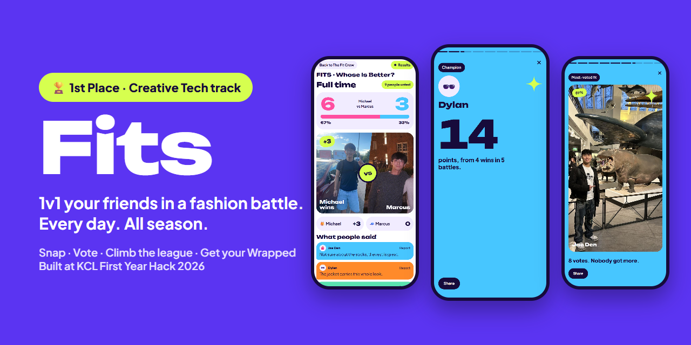
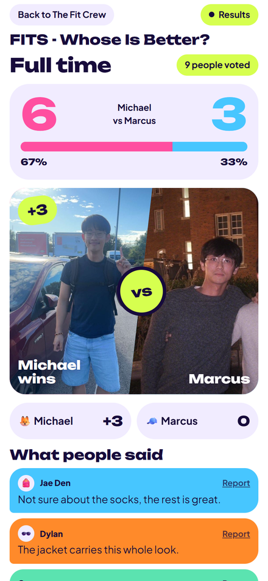
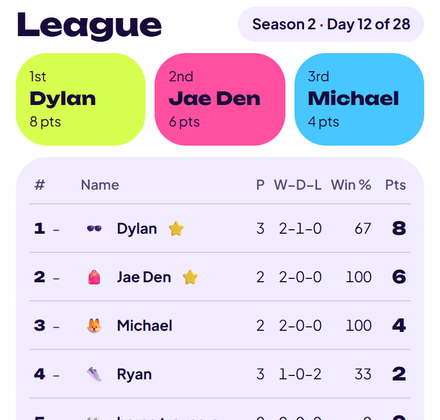
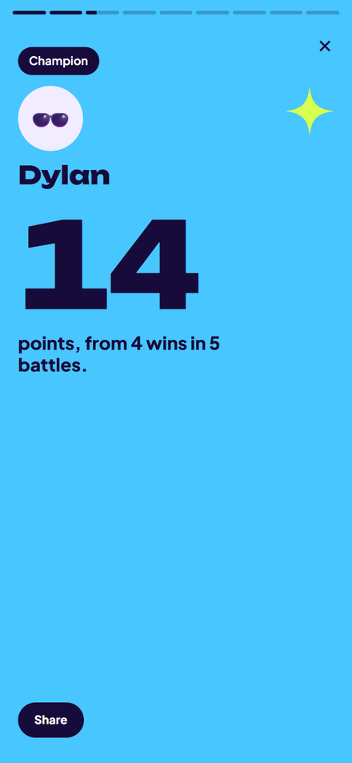
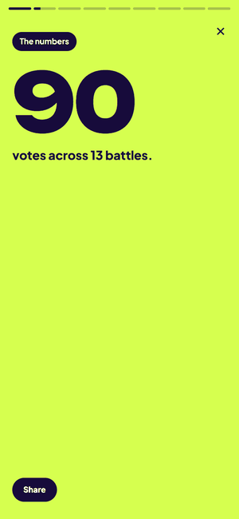

# Fits

🏆 **1st Place, Creative Tech track, KCL First Year Hack 2026**



[](#fits)
[](https://first-year-hack-green.vercel.app)


**1v1 your friends in a fashion battle. Every day. All season.**

Fits is an outfit-battle league for friend groups, built in a day at KCL First Year Hack 2026, where it won **1st place in the Creative Tech track**. Every day the app pairs two people in your group. Both snap their fit with the in-app camera, everyone else votes side by side, and results feed an FPL-style league table. At the end of a season you get a Wrapped-style story recap.

We built it because group chats already argue about whose outfit is better. Fits turns that into a game with a score, a season and a reason to dress up every day.

### 👉 [Try the live demo](https://first-year-hack-green.vercel.app) · [Jump straight into an example group](https://first-year-hack-green.vercel.app/j/fitcrew)

Open it on your phone. No account is needed: pick a name and an emoji and you're in.

> Tone rule: **roast the outfit, never the person.** All user text goes through a word filter, and comments and chat have a Report button.

## Screenshots

| Battle results | League table | Season Wrapped |
|:---:|:---:|:---:|
|  | <br><br> |  |

## Features

- **Join in one tap.** Join with a link, a QR code or an invite code. Anonymous sign-in with a name and emoji, so there's no account to create.
- **Daily battles.** A shuffled round-robin schedule. Matches are revealed at 09:00, you post by 12:00, and results come out at 18:00. Each group can set its own times.
- **Live capture only.** Photos come from the in-app camera (`getUserMedia`). There's no gallery upload, so nobody can post an old pic.
- **Side-by-side voting** for group members, plus an optional **public share link** so anyone (judges, the room) can vote. Votes are anonymous and battlers can't vote in their own battle.
- **Results reveal** with the app's one orchestrated animation (it respects `prefers-reduced-motion`). Admins can **reveal results now**.
- **League table.** Win 3, draw 1, loss 0, forfeit −1. **Outfit of the Week** gives +2 for the highest vote share. The table shows rank movement arrows.
- **Seasons.** The admin starts a season. When it ends, the next one starts automatically, and the admin can change times and battles per day.
- **Wrapped.** 9:16 story cards for each season (champion, rivalry, "ghost" award, top outfit, comment of the season) and a personal monthly Wrapped.
- **Group chat** with the same word filter and reporting.
- **Installable PWA.** Add it to your home screen on iOS or Android.

## Tech stack

| Category | Technologies | What it does in Fits |
|---|---|---|
| Frontend | Vite, React 18, TypeScript, react-router 6, Tailwind CSS 4 | The whole app: camera, voting, league table, Wrapped story cards |
| Backend | Supabase: Postgres with row-level security, anonymous auth, Storage | Stores groups, battles and votes; enforces who can see and do what; holds outfit photos |
| Hosting | Vercel | Serves the app, with SPA rewrites and auto-deploy from `main` |
| PWA | `vite-plugin-pwa` | Makes it installable on a phone home screen and auto-updates it |
| Tests | Vitest (`TZ=Europe/London`) | Unit tests for scoring, scheduling, the league table and Wrapped |

### Architecture in one paragraph

There's no server code of our own. The React app talks straight to Supabase. Rules that must be trusted live in a few Postgres `security definer` functions: `create_group`, `join_group`, `submit_post`, `cast_vote`, `reveal_now`, `battle_by_share_code`, `create_season`, `start_next_season` and `leave_group`. Every table is locked down with RLS. Everything time-based is computed from timestamps on page load by pure, unit-tested TypeScript in `src/lib/`, with no cron jobs. That covers battle phase, scoring, the league table, Outfit of the Week and Wrapped. Pages poll every 5–15 s instead of using Realtime, which copes better with venue Wi-Fi and with RLS-hidden rows.

## Getting started

### Prerequisites
- Node 20+ (developed on Node 26)
- A Supabase project

### 1. Install
```bash
git clone https://github.com/sensei-wu08/First-Year-Hack.git
cd First-Year-Hack
npm ci
```

### 2. Environment
Copy `.env.example` to `.env.local` and fill in values from Supabase → Project Settings → API:
```bash
VITE_SUPABASE_URL=https://<project-ref>.supabase.co
VITE_SUPABASE_ANON_KEY=sb_publishable_...   # the publishable/anon key, which is safe to ship
```
The seed script also needs `.env.seed.local`:
```bash
SUPABASE_URL=https://<project-ref>.supabase.co
SUPABASE_SERVICE_ROLE_KEY=sb_secret_...     # SECRET: never commit it, never put it in Vercel or behind a VITE_ prefix
```
Both files are gitignored.

### 3. Database
In the Supabase **SQL Editor**, run each file in `supabase/migrations/` **in order**, each in a fresh query:

| File | What it does |
|---|---|
| `0001_init.sql` | Tables, RLS policies, views, RPCs, the public `outfits` storage bucket |
| `0002_settings.sql` | Season lifecycle (`start_next_season`, a locked `create_season`) |
| `0003_grants.sql` | Table privileges for the API roles (newer Supabase projects don't auto-grant) |
| `0004_hardening.sql` | Storage MIME and size limits, DB length limits, tighter function grants |

All of them are safe to re-run. Then in Supabase → **Authentication**:
- enable **Allow anonymous sign-ins** (CAPTCHA off)
- raise **Rate Limits → anonymous sign-ins per hour**. A whole room on one Wi-Fi shares one IP.

### 4. Run
```bash
npm run dev      # http://localhost:5173 (the camera works on localhost)
npm test         # unit tests for src/lib
npm run build    # type-check + production build
```

### 5. Seed demo data (optional)
Put outfit photos in `seed/photos/*.jpg` (gitignored), then:
```bash
npm run seed -- --me <your-profile-uid> --reset
```
This creates "The Fit Crew": 8 members, a finished October season and a live November season, with votes and comments. Your profile is one of the members, so personal Wrapped has data. Copy your uid from the app's **Me** screen. `--reset` removes only the seed group and its `seed*`/`crowd*@fitleague.test` users.

## Deployment
1. Import the repo into Vercel with the Vite preset.
2. Add `VITE_SUPABASE_URL` and `VITE_SUPABASE_ANON_KEY` for Production and Preview.
3. **Redeploy** after changing env vars. Vite bakes them in at build time.

Every push to `main` deploys, except pushes that only touch docs (`README.md`, `assets/`, `docs/` and similar). `ignoreCommand` in `vercel.json` skips those builds. It also ignores a change to `vercel.json` on its own, so redeploy by hand after editing only that file. Installed PWAs reload themselves when a new version lands, so **don't deploy during a live demo**.

## Project structure
```
src/
  lib/          pure logic + tests: phase, scoring, scheduler, table, ootw, wrapped, filter, validate, time
  data/         Supabase access: auth, reads, groups, posts, votes, seasons, lifecycle, chat, wrapped
  components/   AppShell, BottomNav, GroupLayout, Camera, PostPanel, VoteSplit, ResultsReveal, LeagueTable, StoryCards, …
  pages/        one file per route (Today, Battle, ShareVote, League, Chat, Settings, Wrapped, …)
  styles/theme.css   all styling and design tokens (single source of truth)
supabase/migrations/ SQL, applied in order in the SQL Editor
scripts/        seed.ts (demo data), make-icons.mjs (placeholder PWA icons)
assets/         README screenshots, Wrapped GIF and the social preview banner
docs/superpowers/    spec, implementation plan, design tokens + mockups
```

## Design
The look is a "sticker-book bento": a violet canvas with chunky coloured tiles, a lime primary colour, and Unbounded with Plus Jakarta Sans. Tokens and mockups live in `docs/superpowers/design/`, and every colour and font comes from `src/styles/theme.css`.

## Future improvements

Ideas we scoped at the hackathon but didn't build:

- **Battle Mode:** instant live 1v1s, challenges and spin-the-wheel matchups.
- **Video fits:** clips of up to 10 seconds alongside photos.
- **AI commentator:** a hype narrator for results, keeping to the tone rule.
- **Weather-aware outfit ideas** from what's already in your wardrobe.
- **Real push notifications** for match reveal, posting deadline and results (the demo shows a mock).
- **Better scheduling for groups over 14**, and **comment likes** for "comment of the season".

## Team
Michael Wu · Marcus Wong · Jae den Lim

Built with help from Claude Code (parallel agent workstreams with a review gate before each merge).

## License
[MIT](LICENSE)
